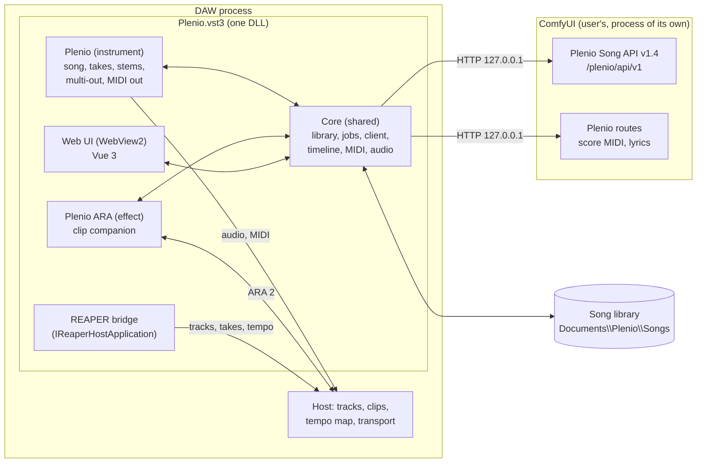

# Plenio VST3: design and plan

| | |
|---|---|
| **Goal** | Plenio (YuE2 song and cover, takes, stems, editable notes, chords and lyrics) as a VST3 plug-in that runs in as many DAWs as possible, with ARA 2 for clip-level integration |
| **Repository** | `D:\Daten2\Deepseek\ComfyUI-MiniMax\Plenio-VST3` (new, local Git, branch `main`) |
| **Plenio** | `D:\Daten2\Deepseek\ComfyUI-MiniMax\Plenio-Music-Production-System` (1.5.1): its Song API is extended there where the plug-in needs more (branch `song-api-1.4`) |
| **Reference** | The SoundCraft add-in (`soundcraft\addins\plenio`, 0.1.1-alpha): takes, stems, the bar-exact tempo map ("the audio is the master"), notes back to Plenio |
| **Platforms** | Windows x64 first; the code is kept portable for macOS and Linux |
| **Plan made** | 2026-11-08 |
| **Last updated** | 2026-11-08 |
| **State** | Phases 0-4 done, 5 and 6 built; 7 (ARA) half done; 8: checked end to end and offline, the owner's DAW test next |

Legend: `[x]` done · `[ ]` open · `[~]` started or partly done · 💡 note

---

## Progress at a glance

| Phase | Content | Status |
|---|---|---|
| 0 | Analysis, design, decisions (this document) | ✅ done |
| 1 | Foundation: repository, dependencies, build, both plug-ins load, web UI in the plug-in window | ✅ done (REAPER check in phase 8) |
| 2 | Plenio Song API 1.4 (in the Plenio repository): stems with every take, bars of a take, model readiness | ✅ done (A4 later) |
| 3 | Core: song library, Plenio client, jobs (1–4 takes a run), timeline math, MIDI, audio files | ✅ done |
| 4 | Engine: takes and stems played in sync with the host, multi-out, MIDI out, state | ✅ done |
| 5 | User interface: new song and cover, song view, takes, piano roll, chords, lyrics, generate | 🔄 in progress |
| 6 | DAW integration: drag and drop, export, REAPER tracks with native takes and the tempo map | 🔄 built; drag and drop and REAPER in the owner's test |
| 7 | ARA 2: Plenio ARA on clips | 🔄 takes recognised, their content for the host, another take in the clip, its window; open: words and notes in the window, covers of any clip |
| 8 | Test version for the owner: end to end, live, in REAPER and Cubase | 🔄 end to end and offline checked; REAPER and Cubase: the owner's test |
| 9 | Alpha release 0.1.0-alpha: in the plug-in, installers, Actions, docs, media, launch | 🔄 started 2026-11-09 |

---

## 1. What the owner asked for (2026-11-08)

1. A VST3 that runs in as many DAWs as possible and makes songs like the SoundCraft add-in. The MIDI data,
   the chords and the lyrics can be changed by hand, and a new take is made from them.
2. Up to **4 takes per run**, all on the **same track** as separate takes. **Stems** as well.
3. Changed data rendered as a **new take, even when the length changes**.
4. **Adding tracks** of one's own must be easy (they must fit the song's bars).
5. Integrated into the DAW as well as possible, **ARA preferred** if feasible.
6. Intuitive to use and a beautiful user interface.
7. Windows first, macOS and Linux possible later.
8. New Plenio versions easy to take in.
9. ComfyUI and Plenio are a precondition for generating. Where Plenio's API lacks something important, extend it
   directly in the Plenio repository.
10. **A saved project works without ComfyUI and Plenio**: everything (playing, editing, takes, stems, export)
    except generating new takes.
11. Done as independently as possible: first a version for the owner to test, then an alpha release on GitHub.

## 2. Core decisions

| # | Question | Decision | Why |
|---|---|---|---|
| D1 | Framework | **Steinberg VST3 SDK 3.8.1 (MIT) and Celemony ARA SDK 2.3.0 (Apache-2.0) directly, no JUCE** | JUCE 9 is AGPLv3 or commercial: it would force a copyleft licence on the project. Plenio and the SoundCraft add-in are permissive (Apache-2.0, MIT). Both SDKs are the reference implementations hosts test against; the ARA Library brings the whole plug-in side of ARA. |
| D2 | Licence | **Apache-2.0**, like Plenio | Every dependency is permissive (see section 11) |
| D3 | User interface | **A web UI (Vue 3, Vite, TypeScript) in WebView2**, through [choc](https://github.com/Tracktion/choc) (ISC), built into the plug-in | Plenio's own frontend is Vue 3 + TypeScript: the same stack, its components and helpers can be reused. Dynamic forms from the Song API's field descriptions are natural in HTML. choc needs no WebView2 SDK on Windows and uses WKWebView and WebKitGTK on macOS and Linux. |
| D4 | Plug-ins | **One bundle `Plenio.vst3` with two plug-ins**: **Plenio** (instrument) and **Plenio ARA** (ARA 2 audio effect, `Fx\|OnlyARA`) | ARA can't create tracks or clips (section 4), so generating needs a plug-in of its own. ARA hosts match the ARA factory to the effect class by name (ARA SDK: "MUST be the same as component name if multiple kVstAudioEffectClass components are used"), so both fit in one bundle and share the song library, the connection and the jobs in one process. |
| D5 | Where songs live | **A song library on disk** (`Documents\Plenio\Songs\<song>\`, configurable): every take's audio, stems, record, score MIDI and bars. **The project's plug-in state holds the whole song without audio** (documents, takes, edits, bars, lyrics timing) as a fallback | Audio does not belong in a DAW's project state (hundreds of MB). With the library and the state, a saved project needs neither ComfyUI nor Plenio (requirement 10). |
| D6 | One instance | **One Plenio instance = one song** | Simple to understand; several songs = several instances |
| D7 | Plenio | **No copy of Plenio in the plug-in** (unlike the SoundCraft add-in): it talks to the user's ComfyUI with Plenio through the versioned Song API and reads its capabilities from `GET /plenio/api/v1` | A new Plenio is taken in by updating ComfyUI's custom node; new fields appear in the forms by themselves (requirement 8) |
| D8 | Tempo | **The audio is the master** (the SoundCraft decision of 2026-11-06): the bars are measured in the take and the DAW's tempo map follows them; the audio is never stretched | A YuE2 render keeps no steady tempo (150–250 ms off a straight line in the median song) |
| D9 | Stems | **From the job itself**: Plenio's template has the stems in its Master subgraph (Separate Stems → Stem Mixer behind a *stems* switch, off by default). API 1.4 gets a job option `stems` that turns the switch on and marks every stem *save* | Stems in the same run and queue (no second model competing for the GPU), about half a minute more per take |
| D10 | Testing against ComfyUI | **A dev instance of ComfyUI of its own** (own `--base-directory`, Plenio's Git folder linked in, the owner's models shared), like the SoundCraft add-in | The owner's ComfyUI (`D:\Daten2\ComfyUI`, Plenio 1.5.0 as a copy) stays untouched |
| D11 | Language | Code, comments, docs, UI text and commit messages in **English**, like Plenio and the SoundCraft add-in | The owner's rule for the SoundCraft add-in (2026-11-06); talk with the owner in German |

## 3. Architecture



| Part | Folder | What it holds |
|---|---|---|
| Core | `src/core` | Plain C++20, no VST3: song model and library (JSON), Plenio client (HTTP), job runner, bar map and tempo map, standard MIDI files, chord symbols, SRT and release records, audio decoding, resampling, peaks, settings |
| Engine | `src/engine` | The real-time part: takes and stems played at the host's sample position, multi-out, MIDI out, lock-free swaps |
| Plug-in | `src/plugin` | VST3: the instrument (single component), parameters, state, the factory of the bundle |
| ARA | `src/ara` | Plenio ARA: document controller, playback renderer, editor view, content readers, take recognition |
| UI host | `src/ui` | The editor window (`IPlugView`) with the WebView, the bridge to the web UI, drag and drop to the DAW, file dialogs |
| Hosts | `src/hosts` | REAPER: its API through `IReaperHostApplication` |
| Web UI | `webui` | Vue 3 + Vite + TypeScript; a mock bridge to develop and test it in a browser |
| Tests | `tests` | Core unit tests (doctest), a small VST3 test host (offline render, state round trip), web UI tests |
| Tools | `tools` | `fetch_deps.ps1`, `build.ps1`, `test.ps1`, `install.ps1`, `dev_comfyui.ps1`, `package.ps1` |

### 3.1 Threads

| Thread | Does | Never |
|---|---|---|
| Audio (host) | `process()`: reads the active take's buffers, writes the outputs and MIDI | allocates, locks, waits, touches files |
| UI / main (host) | the editor, the WebView, the REAPER API, ARA model calls | waits for the network or the disk |
| Workers (own) | HTTP, jobs, downloads, decoding, resampling, peaks, the library | touches the WebView or the REAPER API |

Results go from the workers to the main thread through a queue that a timer drains (a hidden message window on
Windows, `Linux::IRunLoop` later). Audio buffers go to the audio thread by an atomic pointer swap; the old buffers are
freed on the main thread once the audio thread has moved on.

## 4. What ARA can and cannot do, and how the requirements are met per host

ARA 2 gives a plug-in random access to the audio of the clips it is applied to, the host's musical context, and a
way to hand the host musical content (tempo, bars, notes, chords, key). **It cannot create tracks, clips or takes in
the host**, and it cannot lengthen a clip beyond its audio file. Plug-in standards in general (VST3, AU, CLAP)
have no way to add tracks. So the plan has three layers:

| Layer | Hosts | What it gives |
|---|---|---|
| **Universal** (the instrument) | every VST3 host | The song is played by the instrument in sync with the host's timeline (sample-exact, any length). Takes switch instantly inside the plug-in. Stems on 5 extra stereo outputs (the host shows them as channels). Melody, instrument line and chords as MIDI output. Drag and drop of every take, the stems, MIDI with the tempo map and the lyrics into the DAW. |
| **REAPER** (through REAPER's API, `IReaperHostApplication`) | REAPER | The SoundCraft experience: a folder track with the song, **all takes as REAPER takes of one item on the same track**, stem tracks with their takes, MIDI items for melody, instrument line and chords, the lyrics as items with their text, the sections as regions, **the tempo map from the measured bars**. Notes changed in REAPER's MIDI editor are read back for the next take. |
| **ARA 2** (Plenio ARA) | Cubase, Nuendo, Studio One, REAPER, Logic (AU, later), Cakewalk/Sonar | On a clip: recognises a Plenio take and shows its lyrics, notes and chords where they sound in the timeline; editing there feeds the song's next take; plays another take of the song in the same clip; hands the host the take's tempo, bars, notes, chords and key; makes a cover of any clip without exporting it; starts and locates the host's transport. |

How each requirement lands:

| Requirement | Universal | REAPER | ARA |
|---|---|---|---|
| Up to 4 takes per run on one track | take lanes inside the plug-in, the instrument track plays the active one; drag any take onto a DAW lane | native takes of one item | another take in the same clip |
| Stems | 5 stereo outputs; drag | stem tracks with takes | — |
| Edit MIDI, chords, lyrics | piano roll, chord lane and lyrics editor in the plug-in | also REAPER's MIDI editor (read back) | in the clip's editor |
| New take when the length changes | any length plays | the item takes the new length | (clip length is the host's) |
| Own tracks fit the bars | MIDI file with the tempo map (dropped into the DAW); a click track | tempo map set directly | tempo and bars as ARA content |
| Without ComfyUI | all of it, generation off | all of it | all of it |

## 5. Plenio Song API 1.4 (in the Plenio repository)

The SoundCraft add-in needed its own ComfyUI wrapper (`/scp/v1`) for what the Song API lacks. The VST3 asks for
nothing outside the API; what it needs goes into Plenio itself, so every client has it (the SoundCraft add-in can
drop its wrapper routes later):

| # | Addition | What it does |
|---|---|---|
| A1 | job option `"stems": true` | turns the Master's *stems* switch on and marks every strip of the Stem Mixer *save* (`save_all`): Export Release writes the stems (vocals, drums, bass, other, rest) into `<name>-stems/` and lists them in the record (`role: "stem"`); they download through `GET /jobs/{id}/files/{name}` (names with the folder) |
| A2 | `GET /jobs/{id}/bars` | where every bar of the score lies in the take's audio (the SoundCraft add-in's `beats.py`, moved into `plenio/core/bars.py`), measured once and kept beside the record (`<name>.bars.json`) |
| A3 | `GET /models` | per template: ready or not, the missing model files and their sizes (the add-in's `/scp/v1/models`, for every template) |
| A4 | `POST /stems` | stems of an existing take, as a queued job (for takes made without stems, and imported songs) |
| A5 | version | API 1.4, Plenio 1.6.0, `docs/api/README.md`, `fields.md`, `openapi.json`, CHANGELOG, tests |
| A6 | syllables in the score MIDI | `POST /plenio/score/midi/export` puts every sung syllable on its note (lyric events, from the ABC's `w:` lines): the piano roll shows the words under the notes, the DAW's MIDI carries them (later) |

`GET /plenio/api/v1` lists the new paths, so the plug-in sees what a running Plenio offers and turns features on or
off (an older Plenio still makes songs; the tempo map then follows the warp's straight line, stems are off).

## 6. The song: data and files

```
Documents\Plenio\Songs\
└─ Night Drive (s-3fa2b0c1)\
   ├─ song.json                      the song (schema plenio-vst3.song/1), written atomically
   ├─ source\                        a cover's original recording
   └─ takes\
      ├─ 1\  take.flac  original.flac  record.plenio.json  lines.srt  score.mid  bars.json  stems\vocals.flac …
      ├─ 2\  …
      └─ …
```

| Part | Holds |
|---|---|
| Song | id, title, kind (`song`, `cover`), template, the brief's fields, seeds and which are locked, the documents (title, style, lyrics, score, artwork prompt) each `auto` or `manual`, the cover's source, settings (takes per run, stems), the owner's edits (notes, chords), the takes, the active take, the jobs in progress |
| Take (never changed once made) | number, job, what it was made from (fields, documents, seeds), stars and quality, length and rate, files, BPM, key, meter, warp, **bars** (score time ↔ audio time per measure), sections, sung lines, the score as notes (melody, instrument line, chords) with chord symbols, syllables and section marks |
| Edits | changed notes per track and changed chord symbols, kept until the next take; the lyrics are the `lyrics` document marked `manual` |

What the next take is made from follows the SoundCraft add-in's rules (`Song::plan`): a changed brief writes the song
anew; changed words without own notes compose new notes; changed notes are sung as written; nothing changed makes a
new take of the same song. The header always says what Generate will do ("compose new notes for the words, then
render 4 takes").

**The notes go back to Plenio as its own MIDI file**: Plenio's export (`/plenio/score/midi/export`) of the take's
score is kept per take; on Generate, only the changed tracks are written anew (the conductor track and every
unchanged track stay byte for byte), chord symbols as `plenio:chord` text events, and
`/plenio/score/midi/import` turns the file back into the score that YuE2 sings.

## 7. Timeline: bars, tempo map, placing a take

Ported from the SoundCraft add-in (`BarMap`, `Take::lay_out`, `score::tempo_map`):

- **Bars**: every measure's start in score seconds and in audio seconds; between them straight pieces.
- **Lay-out**: the score's first bar sits on a bar line of the project (`scoreAt`, whole bars of the first measure's
  length from the start), the audio where the bars put it against the score (`audioAt = scoreAt - shift`).
- **Tempo map**: lead-in bars at the first measure's tempo, then one tempo event per measure (its quarter notes over
  its measured length), every meter change on its bar. With this map in the DAW, a note keeps its musical position:
  project tick = lead-in + score tick. Own MIDI and the grid fall on the music.
- **Playback** is by time, not by beats: the instrument plays sample `projectSample - audioAt` of the take, whatever
  the host's tempo map says, so the audio is always where it belongs; the tempo map only makes the grid match.
- Several songs in one project share one tempo map; it follows the take chosen last (as in SoundCraft).

## 8. User interface

Dark, calm, Plenio's colours (pink `#ff3d8b`, purple `#8a4dff`, amber `#ffb23e`) as accents; system font; every
icon drawn in SVG for this project. Resizable window, 1100 × 720 by default.

```
┌ Plenio ─ Night Drive ▾ ─────────────── ● Plenio 1.6 · ready ─ ⚙ ┐
│ Take 2 of 4 · 4.5 ★ · 1:32 · 74 BPM · A minor   lyrics changed │
│                       [ Generate 4 takes ▾ ]  compose new notes │
├──────────────┬─────────────────────────────────────────────────┤
│ Brief        │ ruler  1    5    9    13   17   21   25         │
│ Lyrics       │ form  [Intro][ Verse 1 ][Chorus ][ Verse 2 ]…   │
│ Export       │ take 1 ▁▂▅▇▅▃▂▃▅▇▆▄▂▁   4.0 ★                    │
│ Info         │ take 2 ▂▃▆█▆▄▃▄▆█▇▅▃▂   4.5 ★  ◀ active          │
│              │ stems  vocals · drums · bass · other · rest M S │
│ (side panel) │ lyrics [Rain on the asphalt][We ride …]         │
│              │ chords |Am   |F    |C    |G    |                │
│              │ notes  piano roll, syllables under the notes    │
└──────────────┴─────────────────────────────────────────────────┘
```

- **Welcome**: New song, New cover (drop a file), the library, import a Plenio FLAC or `.plenio.json`.
- **New song**: 250 styles with search, an idea or one's own lyrics, length, vocals, language; *More options* holds
  every field of the Song API (built from `GET /templates/{id}`); takes per run 1–4; stems with every take.
- **Song view**: one timeline with the host's playhead: ruler (bars), song form, take lanes (waveforms, stars), stems
  (mute, solo, level), sung lines, chord lane, piano roll (melody with syllables; instrument line and chords on
  demand). Click a take to make it active; double-click to listen while the host stands.
- **Generate** says what it will do and shows each take's progress (stage, queue place) with cancel.
- **Side panel**: Brief, Lyrics (section tags, syllables, the differences to the take), Export (drag tiles: take,
  stems, MIDI + tempo, lyrics; in REAPER: *Put the song on tracks*), Info (quality, models, licence).
- **Offline**: a quiet banner "Studio offline: playing and editing work; generating needs ComfyUI with Plenio"
  with *Start ComfyUI*.

## 9. Making it easy to take in new Plenio versions

- Only the versioned Song API (v1.x) and Plenio's documented routes; nothing of Plenio is copied.
- Templates, fields, choices, styles: read from the running Plenio on every start and cached for offline use.
- Capabilities from `GET /plenio/api/v1` (`version`, `paths`): features turn on when a Plenio offers them.
- `tools/check_plenio.ps1`: the plug-in's contract tests against a live Plenio (templates, briefs, a short job with
  stems, bars, score MIDI round trip).

## 10. Quality rules

- The audio thread never allocates, locks, waits or throws.
- Everything from Plenio, files and the host is hostile: sizes capped, JSON parsed leniently, nothing indexed blindly.
- A failed step tells the user why, in words; nothing fails silently.
- Every bundled asset is original or permissively licensed and listed in `THIRD_PARTY.md`.
- The VST3 SDK's validator passes for both plug-ins on every build.

## 11. Dependencies (all permissive)

| Dependency | Version | Licence | For |
|---|---|---|---|
| Steinberg VST3 SDK | 3.8.1 build 84 | MIT | the plug-in format |
| Celemony ARA SDK | 2.3.0 | Apache-2.0 | ARA 2 |
| choc (Tracktion) | 1.0.1 | ISC | WebView, JSON values, message loop |
| REAPER extension SDK | master | zlib | `IReaperHostApplication`, API declarations |
| nlohmann/json | 3.x | MIT | JSON |
| cpp-httplib | 0.x | MIT | HTTP to ComfyUI on 127.0.0.1 |
| dr_libs (dr_flac, dr_wav, dr_mp3) | master | Public domain or MIT-0 | audio files |
| r8brain-free-src | 6.x | MIT | resampling |
| doctest | 2.4.x | MIT | tests |
| Vue 3, Vite, TypeScript | as Plenio's frontend | MIT | the web UI |

ComfyUI (GPL-3.0) and Plenio (Apache-2.0) are never bundled: the plug-in talks to them over HTTP. The music models
have licences of their own: **YuE2 and SheetSage2 are CC BY-NC 4.0 (non-commercial)**; the plug-in says so before
the first song.

## 12. Risks

| Risk | Answer |
|---|---|
| WebView2 in some host misbehaves (focus, keys, DPI) | choc's WebView is used in plug-ins already; space and other keys not used by the UI are passed on to the host; test in REAPER and Cubase |
| Tempo map import differs per DAW | REAPER is set directly; elsewhere a MIDI file with the tempo map (Cubase: *Ignore Master Track Events on Merge* off) and a click track; documented per host |
| ARA hosts differ | follow the ARA SDK's test plug-in; test in REAPER and Cubase |
| GPU contention (stems while a song renders) | stems come from the job itself (D9); separate stems jobs go through ComfyUI's queue (A4) |
| Several takes per run take long | the jobs queue in ComfyUI and are followed one by one; each take appears when it is ready |
| Projects moved to another computer | the song is in the project state; the audio is found again in the library or a folder the user points to |

---

## Checklist

### Phase 0: analysis and design

- [x] Read the request and the added requirement (a saved project works without ComfyUI and Plenio)
  💡 What was done: the SoundCraft add-in read end to end (plan, development guide, Rust crates, the ComfyUI wrapper with `beats.py`, `stems`), Plenio's Song API (`song_api.py`, routes, the templates and subgraphs, the MIDI export and import, the stems nodes), the tools on this computer (Visual Studio 2022 17.5 with CMake 3.25 and Ninja, Rust 1.99, Node 22, Python 3.11, REAPER 7.10, Cubase 15, two RTX 5060 Ti 16 GB) and the owner's ComfyUI (`D:\Daten2\ComfyUI`, Plenio 1.5.0 as a copy, models on `F:\ComfyUI\models`, started by `~/.plenio/player/comfyui-start.json`).
- [x] Found: Plenio's template separates the stems in every run already and only does not save them (D9)
- [x] Found: ARA hosts match the ARA factory to the effect class by name, so one bundle holds both plug-ins (D4)
- [x] Licences checked: VST3 SDK 3.8.1 MIT, ARA SDK Apache-2.0, choc ISC, REAPER SDK zlib, JUCE 9 AGPLv3 (D1)
- [x] Design and plan written (this file)

### Phase 1: foundation

- [x] `git init`, `.gitignore`
- [x] `tools/fetch_deps.ps1`: every dependency at a pinned version into `external/`, the patch for choc's WebView2 data folder
  💡 What was done: nine dependencies pinned to tags or commits that are at least two weeks old (cpp-httplib releases weekly; 0.60.0 instead of the three-day-old 0.65.0). The patch `cmake/patches/choc-webview-user-data-folder.patch` adds one hook so that WebView2 keeps its data in `%LOCALAPPDATA%\Plenio\VST3\WebView2` instead of a folder named after the host's exe.
- [x] CMake: core library, the `Plenio.vst3` bundle with both plug-ins (fixed class ids), tests; `tools/build.ps1`
  💡 VST3 SDK without VSTGUI and examples, static C runtime (no redistributable needed), C++20, the validator after every build; the web UI is built by npm and compiled into the DLL (`cmake/EmbedFiles.cmake`). The SDK's default bundle icon is the VST logo (a Steinberg trademark): replaced by Plenio's own icon.
- [x] The instrument: buses (main + 5 stem outputs, MIDI in and out), single component, empty state
- [x] Plenio ARA: document controller, playback renderer (pass-through), main factory; `Fx|OnlyARA`
  💡 The renderer caches each clip's samples when the host allows access and plays them back, blocked while the host edits the model (the ARA SDK's pattern, with the counter fixed so that a blocked renderer never leaves it raised).
- [x] Editor window with the WebView (child window, resize, DPI), the web UI built into the binary, the bridge (calls and events)
  💡 Checked in the SDK's editorhost at 150 % Windows scaling (screenshots). Two faults found and fixed: the native function was bound before WebView2 was ready (the page fell back to its browser mock), and the host told the scale only after it had made its window (the page lay off-centre in a window too small). Now the function is bound when WebView2 is ready and the page loads again; after attaching, the view reports what the host really made and asks it to follow the scaled size. Development: `PLENIO_WEBUI_DIR` or `PLENIO_WEBUI_URL` (Vite dev server) load the UI without rebuilding.
- [~] Validator green for both plug-ins; the bundle loads in REAPER
  💡 Validator: 94 tests passed, 0 failed; `moduleinfo.json` lists Plenio (Instrument|Generator), Plenio ARA (Fx|OnlyARA) and the ARA main factory. REAPER only scans `C:\Program Files\Common Files\VST3`, which needs administrator rights: the check in REAPER and Cubase moves to phase 8 with `tools/install.ps1`.
- [x] `README.md`, `LICENSE`, `NOTICE.md`, `THIRD_PARTY.md` (first versions)

### Phase 2: Plenio Song API 1.4 (Plenio repository, branch `song-api-1.4`)

- [x] A1 `stems` job option, stems listed in the record, file route for names with a folder
  💡 What was done: the Stem Mixer's value takes `save_all` (every strip saved, whatever the separation names its stems; the sound unchanged); `"stems": true` sets it and turns on the Master subgraph's *stems* input; `result_file` serves one folder level beside the record and nothing deeper; the result's files carry the stem's name. The first live run saved nothing: the separation sits behind three switches that are off in the templates, so the first idea (only mark the mixer) was not enough. Found in the run's prompt, fixed, pinned by a test, run again: five stems and two stem MIDI files.
- [x] A2 `plenio/core/bars.py` (from `beats.py`, with its tests) and `GET /jobs/{id}/bars`
  💡 The add-in's algorithm unchanged (mypy-strict clean after one rename), its 20 tests moved with it, plus tests for reading a record and the cache `<name>.bars.json`. Live: 58 measures in 0.4 s, 0.03 s from the cache.
- [x] A3 `GET /models`
  💡 Live it found something real on this computer: `flux2-vae` (cover art) has another size than the catalogue says, so the templates count as not ready; the plug-in will name the file and say that cover art needs it.
- [ ] A4 `POST /stems` (queued) - later: stems now come with the take; for older takes and imported songs it is still open
- [ ] A6 syllables in the score MIDI export - later (found while building the piano roll: the export has no lyric events)
- [x] A5 version 1.6.0 / API 1.4, docs, OpenAPI, CHANGELOG (an "unreleased" section); Plenio's tests green
  💡 2012 passed, 1 skipped (was 1980 + 1 skipped for 1.5.1); mypy strict and ruff clean. `GET /` lists `features: ["stems", "bars", "models"]`: the plug-in turns features on by them. Commits `de099e9` and `e93f68b` on `song-api-1.4` (not pushed, not merged).
- [x] `tools/dev_comfyui.ps1`: a dev instance of ComfyUI on its own port with the Plenio Git folder; a live job with stems and bars
  💡 Port 8190, its own base folder with only the link to the Plenio checkout, the owner's models and GPU options from `comfyui-start.json`. Live: a 1:21 song with stems in 137 s, the stems downloaded, the bars measured.

### Phase 3: core

- [x] Song and take model, JSON round trip, sanitising of hostile input
  💡 `core/song`: the song in the project (state) and in the library are the same JSON; every field capped and checked; the score MIDI of each take kept in base64, so a project plays and edits without the library's score files.
- [x] Library: folders, atomic writes, song list, finding moved files
  💡 `Documents\Plenio\Songs\<title> [<id>]`: a song is found by its id, wherever its folder moved or was renamed; files are written next to the target, then renamed.
- [x] Plenio client: discovery (8188, 8000, `comfyui-start.json`), capabilities, templates and briefs cached, errors in words
  💡 `core/studio`: one per process, watches the connection (3 s while looking, 10 s when connected), caches templates, styles and models in `api-cache.json`: the forms work when ComfyUI is not running.
- [x] Starting ComfyUI from the remembered start
  💡 The owner's own start (`~/.plenio/comfyui-start.json`) runs detached with its log in the cache folder; nothing in the ComfyUI install changes.
- [x] Job runner: 1–4 takes a run (a new song: the first take writes and composes, the others follow with its documents), downloads, score MIDI, bars, stems, cancel, resume after reopening
  💡 `core/session`: edited notes are spliced into the take's MIDI and imported as the score; jobs carry an idempotency key; a run saved in the library is followed again when the project opens.
- [x] Plan rules (what Generate does) ported from the SoundCraft add-in
  💡 rewrite (brief changed), recompose (words changed), sing your notes (notes or chords changed), new take.
- [x] Bar map, lay-out, tempo map (ported, with the add-in's tests)
- [x] Standard MIDI files: read Plenio's, write the DAW's (tempo map, sections, chords, lyrics), splice changed tracks for Plenio
  💡 Reading, splicing and the tempo map are here; the DAW's files are written in phase 6 with drag and drop.
- [x] Chord symbols (parse, voice), SRT, release record (lines, warp, stars)
- [x] Audio: FLAC/WAV/MP3 decoding, resampling to the host's rate, peaks for the waveforms
  💡 dr_libs and r8brain; peaks cached per take (`peaks-1600.json`).
- [x] Unit tests
  💡 26 cases, 16249 assertions (doctest), run after every build.

### Phase 4: engine

- [x] Take and stems played at the host's sample position; any block size and rate; loops and jumps
  💡 `engine/player`: the audio thread reads the take at the host's project sample, so loops, jumps and offline render need nothing extra; a new take is swapped in without locks and crossfaded over 6 ms; old takes are freed off the audio thread.
- [x] Main output modes: mix, stems summed, instrumental, vocals only; stem levels, mute and solo
  💡 Mute, solo and level per stem give the modes (instrumental: vocals muted).
- [x] Stem outputs (5 stereo buses), MIDI out (melody ch. 1, instrument line ch. 2, chords ch. 3)
  💡 An activated stem output takes its stem out of the main output.
- [x] Listening while the host stands (preview)
- [x] State: settings and the song (without audio) in the project; reopening with and without the library
  💡 The newer of project and library wins; without the library the project keeps the song, its documents and scores: editing works, playing needs the audio.
- [x] Test host: offline render at several positions, block sizes and rates against the expected samples
  💡 `tests/engine/test_player.cpp`.

### Phase 5: user interface

- [x] Design system (colours, type, controls, icons), the bridge with a mock for the browser
  💡 Plenio's colours (pink, purple, amber on a dark ground), Segoe UI Variable, drawn SVG icons; outside the plug-in a demo answers (`npm run build:mock`, `?state=song|empty|busy|offline|new`) with data captured from Plenio 1.6.0; the plug-in's own build leaves the demo out (145 KB).
- [x] Welcome, connection status, settings (library folder, ComfyUI)
  💡 A banner says when the studio is offline (playing and editing still work) and offers *Start ComfyUI*; the models' licences are asked before the first song, as the add-in asks.
- [x] New song and new cover (styles, idea or own lyrics, every field, takes per run, stems)
  💡 The form is Plenio's own (`frontend/src/player/make/form.ts`, ported): a style fills every field, only the fields that apply are shown and sent, *More settings* holds the rest of the template (cover art off by default: a DAW has no use for it).
- [x] Song view: ruler, form, take lanes with waveforms and stars, stems, sung lines, playhead
  💡 Every lane on the project's seconds, the bars as measured in the take; takes in the making lie where the song will be, with their progress.
- [ ] Piano roll (select, move, lengthen, draw, delete, transpose, snap), syllables under the notes
  💡 All but the syllables.
- [x] Chord lane (pick root and quality), lyrics editor (section tags, differences)
  💡 Click a chord to change it, double-click the lane for a new one: Plenio's 15 qualities and a bass note.
- [ ] Generate: what it will do, progress per take, cancel; undo and redo of edits
  💡 All but undo and redo across edits (the piano roll has its own undo).
- [x] Screenshots of every view checked
  💡 In the browser (demo) and in the plug-in in EditorHost at 150 % scaling, driven by `tools/dev/cdp.mjs`.

### Phase 6: DAW integration

- [x] Drag and drop to the DAW (Windows OLE): take, stems, MIDI with tempo, lyrics
  💡 The shell's own data object (as Explorer drags files, which every DAW takes); a drag starts only while a mouse button is down; a tile per file in the DAW tab and a grip on every take. Tried by hand in the owner's test (it needs a real mouse).
- [x] DAW-ready files: audio padded to start at the project's start, MIDI with tempo map, sections, chords and lyrics, a click track
  💡 `core/daw_export` (tested): 24-bit WAV of the take and its stems with the lead-in as silence, the score as MIDI (tempo of every measure, meters, key, sections as markers, sung lines as lyrics, the chords voiced and named), one MIDI file per part, the tempo map alone, a click on every beat; in `takes/<n>/daw`, made once per take (about 3 s), the MIDI again before every drag so the latest edits go along.
- [~] REAPER: the song on tracks (folder, takes, stems, MIDI, lyrics, regions, tempo map), take choice both ways, notes read back
  💡 Built through `IReaperHostApplication`, as the SoundCraft add-in lays the song out: a folder, Lyrics (an item per line), Song (every take of the song as one of REAPER's takes), Melody, Instrument Line, Chords (muted), the stems; regions; the tempo map from the take's bars (optional). The take chosen on the Song track and in Plenio stay the same; the instrument is quiet while REAPER plays the tracks. The audio keeps its time (timebase Time): a tempo map moves REAPER's grid onto the song, never the song. The owner's first test found a take dropped in before the tempo map playing at 76/120 of its speed (REAPER's default timebase stretches items when the tempo changes): Plenio now keeps any of its audio in the project in time (once per item, so a timebase chosen later stays), *Put on tracks* sets the tempo map before the items and replaces only the items it made. Tested against a fake REAPER that stretches items as REAPER's timebase does (`tests/plugin/test_reaper.cpp`). Open: notes read back from REAPER's MIDI. Not tried in REAPER yet: the owner's test (an automated REAPER run cannot be kept apart from the owner's REAPER settings).
- [x] Keys the UI does not use go to the host (space)
  💡 REAPER: its own play/stop action; other hosts: the key posted to the host's window that holds the editor.

### Phase 7: ARA

- [x] Plenio ARA recognises Plenio takes (name and fingerprint)
  💡 By the name the plug-in gives every file (`<title> - Take <n>[ - <stem>]`, with a DAW's own suffixes) and the length, which also tells the DAW's file (padded with the lead-in) from Plenio's own: no fingerprint needed. `core/clip_content`, tested.
- [x] Content for the host: tempo, bars, notes, chords, key
  💡 For audio sources and modifications: a tempo entry per measured bar, the meters, the key, the sung notes (the song and its vocal stem), the chords with roots on the circle of fifths, diatonic degrees and names with ♭ and ♯. The ARA SDK's ARATestHost passes all ten of its tests (`tools/dev/ara_test.ps1`; the test host itself hangs now and then on start, the SDK's own test plug-in too, so the script starts it again).
- [x] Playback: pass-through, or another take of the song in the same clip
  💡 Pass-through tested. Another take: its DAW file (made when missing), read and brought to the clip's rate on a worker, swapped in while the renderers wait; every take's file starts at the project's start, so the same samples line up (a stem's clip plays the same stem). The host's tempo map stays the clip's take's. Tried in a DAW in the owner's test (no ARA host here plays it).
- [~] Editor view: the clip's song, lyrics, notes and chords in the timeline; transport control
  💡 Plenio ARA's window lists the project's clips that are Plenio takes and switches the take that plays in each. Open: the take's lyrics, notes and chords in that window.
- [ ] A cover of any clip

### Phase 8: test version

- [x] Live end to end with the dev instance: a new song with 4 takes and stems; notes, chords and lyrics changed; a new take of another length; a cover
  💡 In EditorHost on the dev ComfyUI: a new song; a changed line, two takes with stems (1:35 instead of 1:55, another key); ten notes and a chord changed: the new take sings exactly them; a cover of a take (2:47); a run of four takes with stems (about two minutes a take).
- [x] Reopened without ComfyUI: everything but Generate works
  💡 The song opens from the library with its takes, waveforms, words, chords and notes; editing works; Generate is off and says why. Reopening a saved DAW project without ComfyUI: the owner's test.
- [ ] REAPER and Cubase: loaded, played, dragged, ARA applied
  💡 REAPER 7, first finding: a new song made and dragged in; the take slowed down when the tempo map came. Fixed (phase 6), in the owner's next test.
- [x] `tools/install.ps1`, a short test guide for the owner
- [x] The owner's test: the cover art Plenio painted was nowhere to be seen
  💡 Plenio hands it over as a JPEG of its own (the job's file with the role `cover`) and embeds it in the take's FLAC: the plug-in fetched neither. Now each take keeps its cover beside its audio (fetched with the take, or taken from its FLAC, also for songs made before), the song's folder keeps `cover.jpg` (the chosen take's, else the newest take's), the window shows it (the song's header with a large view, the take lanes, the song list; served at `/files/cover/…`), and REAPER's song folder and Song track get it as their icon. Checked in EditorHost with the owner's take (its 1024 × 1024 cover from the FLAC); a run with cover art: the owner's test. No API addition needed.
  💡 `docs/TESTING.md`: REAPER and Cubase step by step, and how to give the owner's ComfyUI Plenio 1.6.0.

### Phase 9: alpha release 0.1.0-alpha

The owner (2026-11-09): good enough for 0.1.0-alpha; everything ready for the release, as for the SoundCraft add-in's.
Publishing (GitHub, YouTube, posts) stays the owner's.

**In the plug-in**
- [x] Every DAW's own steps in the DAW tab, the host the plug-in runs in first (tempo map, stems' outputs, MIDI out, ARA, audio that follows the tempo)
  💡 `webui/src/daws.json`: REAPER, Cubase and Nuendo, Studio One, Ableton Live, FL Studio, Bitwig Studio, Cakewalk and Sonar; Logic and Pro Tools say why not (no VST3). The DAW tab knows the host by its name and lets you pick another; `docs/DAWS.md` is written from the same file (`tools/docs/make_daws_md.py`, `--check` for CI).
- [x] No version in pictures: the version only in Settings
  💡 Plenio ARA's window no longer shows it; the demo data says `0.1.0-alpha` (no "preview").
- [x] An older Plenio: what a newer one brings and how to update it (ComfyUI Manager)
  💡 The status pill says *update* when Plenio lacks stems or bars or is older than recommended (`resources/plenio-compat.json`, read by the build); a click shows what and how.
- [ ] New Plenio versions reach the plug-in by themselves (styles, fields, models from the Song API); what does not is caught by a check against each Plenio release (GitHub Actions) and taken over by one script

**Installers and builds**
- [ ] Windows: an installer that puts the bundle into `C:\Program Files\Common Files\VST3` (and takes it out again), a portable zip
- [ ] macOS: the bundle (universal) built by GitHub Actions, a `.pkg` into `/Library/Audio/Plug-Ins/VST3`; untested here (no Mac): experimental
- [ ] Linux: the core and its tests build (WSL here, GitHub Actions); the plug-in's window on Linux (GTK in the host's X11 window) when possible
- [ ] GitHub Actions: CI on every push (build, tests, validator), the release on a tag (installers, checksums, the release's text as a draft), the Plenio check

**Documentation**
- [ ] README: what Plenio VST3 is, in a minute; pictures; install; DAWs; links
- [ ] Tutorial for beginners, with screenshots and animations (REAPER, and what differs elsewhere)
- [ ] The DAWs: every one's own steps (also in the plug-in)
- [ ] Development guide, CHANGELOG, how new Plenio versions come in
- [ ] How to release: the GitHub repository from nothing, the Actions, the tag, the release

**Media and launch**
- [ ] A demo song made with the plug-in in the owner's REAPER 7 (the owner's wish: screenshots and runs in it)
- [ ] Logo, banner, social preview, screenshots (no version in them), animations
- [ ] The teaser: animated, at once clear what it offers (16:9, 9:16 for Shorts, Reels and TikTok)
- [ ] The tutorial as a video: every important step, light and short
- [ ] The marketing toolkit: texts for every channel (no X; Reddit with care, in the author's own voice), which picture or video goes with which post
- [ ] The release's text

---

## Change log

| Date | Change |
|---|---|
| 2026-11-08 | Plan made after reading the SoundCraft add-in and Plenio; decisions D1–D11; the owner's added requirement (projects usable without ComfyUI and Plenio) in D5 |
| 2026-11-08 | Phase 1 done (bundle, validator, WebView editor checked at 150 % scaling); phase 2 done: Plenio 1.6.0 with Song API 1.4 (stems, bars, models), checked live on a dev ComfyUI; D9 corrected (the stems sit behind a switch) |
| 2026-11-08 | Phases 3 and 4 done; phase 5: the whole UI; the first song made end to end in the plug-in (EditorHost, dev ComfyUI) found the release's `sheet_music` sent as a switch (it is a choice): fixed; `PLENIO_VST3_HOME` keeps development apart from the owner's settings and songs |
| 2026-11-08 | Phase 6 built: files for the DAW, drag and drop, REAPER tracks, the space bar; A6 (syllables) noted for later |
| 2026-11-08 | Phase 7: Plenio ARA recognises takes and gives hosts their tempo, bars, key, notes and chords (ARATestHost: all tests pass); phase 8: end to end (edited notes sung, a cover, four takes with stems) and offline checked, install script and test guide |
| 2026-11-08 | Phase 7: another take of the song in a clip, chosen in Plenio ARA's window |
| 2026-11-08 | The owner's first REAPER test: a take dropped in before the tempo map played at 63 % of its speed (REAPER's default timebase stretched it). Plenio's audio in REAPER keeps its time, *Put on tracks* sets the tempo map first and leaves the user's items alone; tested against a fake REAPER; the tests keep apart from the owner's log; the log in local time |
| 2026-11-09 | The owner's test: the cover art fetched and kept (`cover.jpg` in the song's folder), shown in the window, the icon of REAPER's song tracks |
